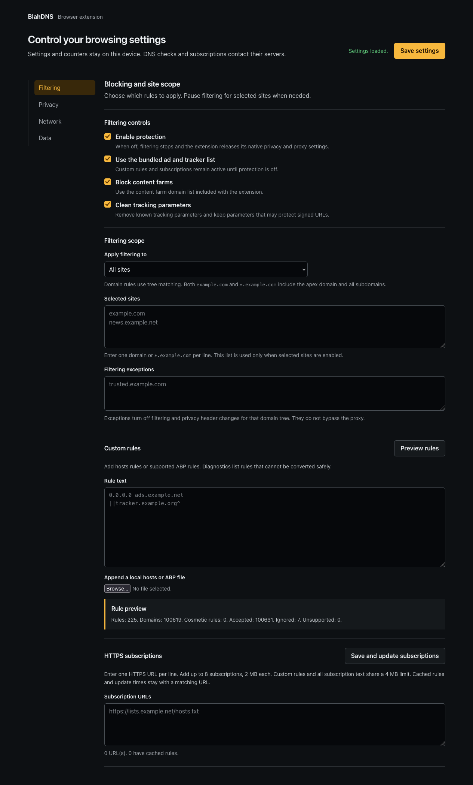

# BlahDNS Browser Extension

> **0.1.0 preview:** 36 unit tests and real Chrome, Brave, and Firefox integration checks pass. This is a manual-install prerelease. See [validation evidence and limits](docs/evals/acceptance-output.md).

A Manifest V3 privacy extension for Chrome, Brave, and Firefox. It blocks known ad and tracking domains, filters supported hosts and ABP rules, removes selected tracking parameters, and provides optional native privacy and proxy controls. Settings and counters stay in your browser.

## What it does

- Compiles filter lists into browser declarative network request (DNR) rules. Rules can block WebSocket requests when they match supported list rules and browser DNR behavior.
- Applies filtering globally or to selected site domains. `example.com` and `*.example.com` both match the apex and all subdomains; label boundaries keep `badexample.com` from matching `example.com`. Exceptions take priority.
- Supports a documented subset of hosts, ABP network, and CSS cosmetic rules. Unsupported rules are reported with diagnostics; see [architecture](docs/architecture.md).
- Keeps settings, filter text, and optional aggregate counters in browser-local storage. No browsing history, telemetry, or cloud settings sync is part of the design.
- Offers optional HTTP, HTTPS, SOCKS4, and SOCKS5 proxy routing by the **destination hostname**. A paused filtering exception does not bypass the proxy.
- Offers opt-in Firefox native Resist Fingerprinting. It is a browser-wide policy that may normalize timezone and language and limit canvas, audio, and WebGL fingerprint surfaces; it can affect site compatibility. The extension does not inject JavaScript to fake those values.



## Browser limits

The extension does not make a browser anonymous or guarantee that a site will accept a request. Chrome and Brave do not expose a Firefox-style extension switch for broad native fingerprint resistance. Use [Brave Shields](https://support.brave.com/hc/en-us/articles/360022806212-How-do-I-use-Shields-while-browsing) for Brave's browser-owned controls. HTTP/2, HTTP/3, QUIC, and proxy fallback behavior are controlled by each browser and network stack; the extension cannot force a protocol or promise that every connection uses a selected proxy.

A Cloudflare challenge can fail for many reasons, including blocked challenge scripts, browser settings, network problems, or bot signals. Temporarily pausing filtering for a site may help diagnose a conflict, but this extension does not bypass CAPTCHAs or guarantee a challenge will pass. See [Cloudflare's troubleshooting guide](https://developers.cloudflare.com/cloudflare-challenges/troubleshooting/challenge-solve-issues/).

## Install a prerelease

The [GitHub prereleases](https://github.com/fun-ed/blahdns-browser-extension/releases) are for manual testing. A GitHub ZIP is not a signed store package. Firefox needs a signed XPI for permanent installation; this prerelease uses temporary add-on loading.

1. Download and extract the Chromium or Firefox ZIP from a prerelease, or build locally using the commands below.
2. In Chrome or Brave, open `chrome://extensions`, enable Developer mode, select **Load unpacked**, and choose the extracted Chromium folder that contains `manifest.json`. A source build puts it in `dist/chromium`.
3. In Firefox, open `about:debugging#/runtime/this-firefox`, choose **Load Temporary Add-on**, and select `manifest.json` in the extracted Firefox folder. A source build puts it in `dist/firefox`. A temporary add-on is removed when Firefox restarts.

Store signing, review, and listing are separate from this GitHub prerelease. The manifests declare Chrome 121 and Firefox 140 as minimum versions. The current runtime matrix covers Chrome 157, Brave Beta on Chromium 157, and Firefox Developer Edition 160. Older declared versions have not been tested.

## DoH endpoints are manual settings

The SG and DE BlahDNS endpoints are provided for manual browser DNS-over-HTTPS setup:

- Singapore: `https://doh-sg.blahdns.com/dns-query`
- Germany: `https://doh-de.blahdns.com/dns-query`

The extension's **Test DNS** action sends a fixed `example.com` A query to the chosen endpoint and reports the response and latency. It is only a connection diagnostic. It does not change browser or operating-system DNS settings, route other DNS traffic, or prove that all browser lookups use that resolver.

## Lists and rule limits

The current bundled snapshots are derived from [HaGeZi DNS Blocklists](https://github.com/hagezi/dns-blocklists) and [Content Farm Terminator](https://github.com/danny0838/content-farm-terminator). The current metadata records upstream revisions, licenses, input/output SHA-256 hashes, converted counts, and skipped farm entries in `extension/lists/sources.json`; full upstream files are under `data/upstream/`. Both baseline lists contain domains only, not cosmetic selectors. Refreshes are deliberate project changes. User HTTPS subscriptions are fetched only when the user requests an update. Lists are untrusted text, never executable code.

The compiler currently enforces a 4,500-rule cross-browser budget and a 900-regex budget. Browser quotas and rule behavior can vary by version and by other installed extensions. A list rule outside the supported subset is diagnosed rather than treated as fully implemented.

## Permissions

The generated manifests request local storage, DNR and host access, the privacy API, and scripting access for cosmetic CSS. No page script is injected. The optional `proxy` permission is requested when proxy routing is enabled. Debug rule feedback supplies counters only where the browser exposes it. See [the permission rationale](docs/architecture.md) and inspect the built manifests before each release.

## Development

Use the repository's mise-managed Bun 1.4.4 from `mise.toml`. `bun fmt --check` is Bun's built-in formatter, and `bun lint` is the repository's own check. All commands must run through mise:

```sh
mise exec -- bun install
mise exec -- bun fmt --check
mise exec -- bun lint
mise exec -- bun test
mise exec -- bun run build
mise exec -- bun run check
mise exec -- bun run test:browser
mise exec -- bun run benchmark
```

The [validation record](docs/evals/acceptance-output.md) links the actual test, browser, DNS, package, security, and compiler outputs. The only direct development dependency is puppeteer-core for real browser tests. The extension has no runtime dependency. See [CONTRIBUTING.md](CONTRIBUTING.md), [AGENTS.md](AGENTS.md), and the repository-local [development](skills/extension-development/SKILL.md) and [release](skills/extension-release/SKILL.md) skills.

## Project notes

- [Privacy policy](PRIVACY.md)
- [Architecture and supported rule syntax](docs/architecture.md)
- [Research and source limitations](docs/research.md)
- [Roadmap](docs/roadmap.md)
- [Changelog](CHANGELOG.md)
- [License](LICENSE)
