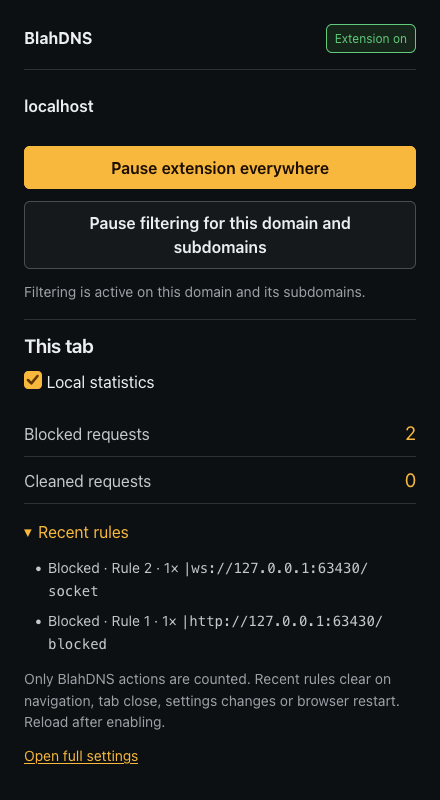

# BlahDNS Browser Extension

A Manifest V3 privacy extension for Chrome, Brave and Firefox. It blocks ads, trackers and content farms, removes known tracking parameters, and provides optional native privacy and proxy controls. Settings, optional aggregate counters and temporary per-tab rule hits stay in your browser. No telemetry or browsing history is uploaded.

Current release: [0.2.6 preview](https://github.com/fun-ed/blahdns-browser-extension/releases/tag/v0.2.6). See [verification and limits](docs/evals/0.2.6/acceptance-output.md).

## Features

- Global or selected-domain filtering, domain exceptions, hosts files, supported ABP rules and cosmetic CSS. `example.com` and `*.example.com` both include the apex and its subdomains. Unsupported rules appear in diagnostics.
- Known tracking-parameter removal with signed-URL exceptions.
- Destination-scoped HTTP, HTTPS, SOCKS4 and SOCKS5 proxies. Selected destinations have no direct failover. Filtering exceptions do not bypass the proxy.
- Native WebRTC policies and opt-in Firefox Resist Fingerprinting, both browser-wide. User-Agent and en-US options affect HTTP headers only.
- Settings import/export, optional local counters and recent matching rules in the popup, and System, Light and Dark appearances.




## Install

Download a package from [GitHub releases](https://github.com/fun-ed/blahdns-browser-extension/releases) and verify it against `SHA256SUMS`.

- Chrome/Brave: extract the Chromium ZIP, open `chrome://extensions`, enable Developer mode, then select **Load unpacked** and the folder containing `manifest.json`.
- Firefox: open `about:debugging#/runtime/this-firefox`, select **Load Temporary Add-on**, then the intact XPI or `manifest.json` from the extracted Firefox ZIP. The XPI is unsigned, and temporary installation ends at browser restart. Ordinary permanent installation requires Mozilla signing.

The manifests declare Chrome 121 and Firefox 140 minimums. Tested versions are Chrome 157, Brave Beta on Chromium 157 and Firefox Developer Edition 160. Store packages and CRX are not provided.

In the popup, enable **Local statistics**, then reload the site. **Blocked requests** and **Recent rules** show this extension's actions; unrelated failures or other blockers are not counted. Recent data clears on navigation, tab close, settings changes, opt-out, reset or browser restart. Firefox uses the newly required `webRequest` and `webRequestBlocking` permissions; Chrome/Brave statistics require the unpacked installation above. No browser debug preference is required on Firefox.

## Lists

The offline default is [BlahDNS Lite ABP](https://oooo.b-cdn.net/blahdns/lite_adblocker.txt), with a separate Content Farm Terminator domain list. **Filtering → Update list** downloads and caches the default list on request, up to 4 MB. Failed updates preserve previous rules. Custom HTTPS subscriptions allow 2 MB per list and 4 MB combined custom text. No startup or scheduled download runs.

See [supported syntax and permissions](docs/architecture.md). Source revisions, licenses and hashes are recorded in `extension/lists/sources.json`; original inputs remain in `data/upstream/`.

## DNS and privacy limits

Configure browser DoH manually with either endpoint:

- SG: `https://doh-sg.blahdns.com/dns-query`
- DE: `https://doh-de.blahdns.com/dns-query`

**Test DNS** sends a fixed `example.com` query. It does not configure or prove which resolver browser traffic uses.

**Recorded browser DoH status** saves your manual On/Off confirmation, or Not confirmed. Choose a value and save settings; it is included in settings import/export. It does not change or detect browser DoH, and DNS tests do not update it.

The extension does not inject fingerprint-spoofing scripts or guarantee anonymity or CAPTCHA acceptance. Chrome/Brave retain browser-native fingerprint controls; use [Brave Shields](https://support.brave.com/hc/en-us/articles/360022806212-How-do-I-use-Shields-while-browsing) where applicable. HTTP/2, HTTP/3, QUIC, UDP and existing connections depend on browser/network behavior; the extension cannot promise every connection uses a proxy. See [privacy policy](PRIVACY.md).

## Development

Use the mise-pinned Bun runtime:

```sh
mise exec -- bun install --frozen-lockfile
mise exec -- bun run build
```

Source builds produce `dist/chromium` and `dist/firefox`. Pinned `tldts` and `re2js` dependencies are bundled locally for Firefox PSL classification and linear-time regex matching; puppeteer-core supports browser tests. No WebAssembly or remote code is required. See [contributing](CONTRIBUTING.md) for checks, [runtime contract](CONTRACT.md) for interfaces, [references](docs/research.md) for design sources, and [changelog](CHANGELOG.md) for release history.

Licensed under [GPL-3.0-only](LICENSE). Third-party notices are in [NOTICE.md](NOTICE.md).
