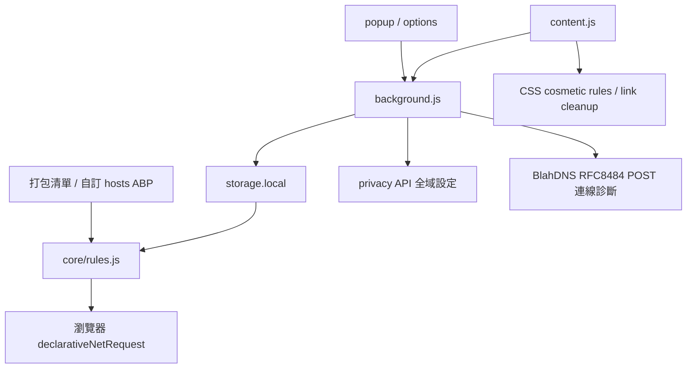

# BlahDNS Browser Extension 實作計畫

## 需求與範圍

建立 Chrome、Brave、Firefox 共用的 MV3 隱私擴充套件。專案只修改 `blahdns-browser-extension/`。追蹤 issue：N/A。核心程式包含清單解析、DNR 規則、設定資料格式與權限，屬 Core，須安全與行為檢查。

## 架構

## 實作決策

- 無遠端程式碼、無遙測、無雲端設定同步。採原生 JS modules、瀏覽器 DNR 與本機 storage。
- hosts、ABP 網路規則與 CSS cosmetic 子集必須回報不支援項目，不能悄悄改變語意。已知規則配額必須在套用前驗證。
- adblock 與 CleanURL 可全域或指定 domain、`*.domain`；例外優先。主機名須標準化與防止後綴誤比對。
- WebRTC policy 與 Firefox resistFingerprinting 是全域設定，保留原本設定並用 clear 釋放控制。Chrome／Brave 無原生抵抗所有指紋的 extension API。
- UA header override 是進階相容性工具，保留原生為預設；UI 必須揭露 JS、Client Hints、TLS 與 workers 的一致性限制。
- DoH 僅提供 SG／DE 正式 endpoint、明確的手動設定教學與 POST 診斷，不能宣稱已控制全部 DNS。
- 預設不注入 JS 指紋噪音。提供 Firefox 原生抗指紋控制及 Chrome／Brave timezone、language、audio、canvas、WebGL 能力說明。不能保證免 CAPTCHA。
- 打包可重現的已授權 ad/tracker 與內容農場清單，記錄來源、版本、SHA256 和授權。使用者可載入本機 hosts／ABP 或 HTTPS 訂閱，更新僅手動執行。

## 驗證

- Node 內建測試驗證 hosts/ABP、拒絕未知 modifiers、domain/wildcard、設定 import/export、URL 清理與簽章保留。
- 真實瀏覽器安裝測試 DNR 封鎖／逐站例外／redirect／header、設定持久化與 privacy 控制。
- 封裝 ZIP、Firefox web-ext lint、JS syntax 檢查及 UI screenshot。發行前比對內容與 checksum。
- 情境一：全域啟用後封鎖測試 tracker，UTM 被移除，正常參數保留。
- 情境二：停用 `example.test` 與子網域 wildcard 邊界，排除站正常載入；無關 suffix 不得放行。
- 情境三：匯入不合法設定、過量規則、未知 ABP modifier，顯示明確錯誤且保留原本作用中的規則。

## 發行

README、CHANGELOG、AGENTS.md、維護與發行 skills、license、privacy policy、架構與來源文件；建立 `fun-ed/blahdns-browser-extension` public repo，發布標示能力限制的 prerelease 與 Chrome/Brave ZIP、Firefox ZIP、SHA256。

## 風險與回退

封鎖清單可能誤判；使用 popup 暫停網站或移除訂閱。URL 清理保留簽章 URL。UA override 與 Firefox 原生 RFP 可能影響登入、時區或驗證，必須 opt-in。移除 extension 釋放全域設定。瀏覽器商店簽章／上架不屬 GitHub release；須列出目前安裝限制。
