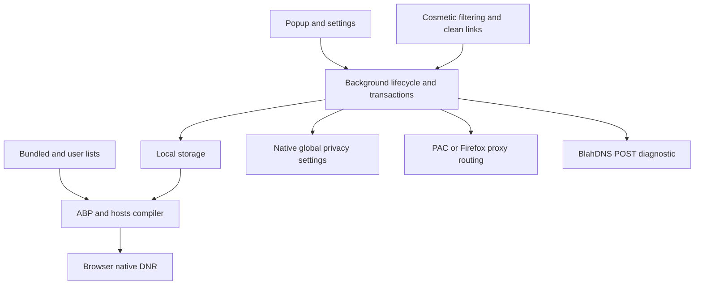

# Implementation plan

Date: 2026-11-09. Issue: N/A. Classification: core. Security review covers permissions, list input, settings messages, DNS parsing, and proxy failover.

## Goal

Build a local privacy WebExtension for Chrome, Brave, and Firefox. Keep the runtime small and maintainable. Use Bun for development and native browser DNR for request filtering. Keep all work in this repository. Publish the source and a GitHub prerelease under `fun-ed/blahdns-browser-extension`.

## Scope

- Domain ad/tracker and content-farm lists. User hosts, an explicit ABP subset, CSS hiding rules, HTTPS subscriptions, and diagnostics for unsupported syntax.
- Global or selected-site filtering. Domain and `*.domain` patterns both include the domain and its subdomains. Exceptions take precedence.
- Known tracking parameter removal with signed-URL exceptions. Local, optional aggregate statistics. Settings import and export.
- Native global WebRTC IP policy. Optional HTTP User-Agent and en-US language headers. Firefox native fingerprint resistance. Clear guidance for native timezone, audio, canvas, WebGL, and browser metadata controls. Keep original browser values by default.
- Manual BlahDNS SG/DE DoH setup and RFC8484 POST diagnostics. An extension cannot set the browser resolver through a normal WebExtension API.
- WebSocket handshake filtering. HTTP, HTTPS, SOCKS4, and SOCKS5 proxy configuration with independent destination-domain scope. Request proxy permission only on user action. No direct fallback for a selected proxy destination.
- Document HTTP/2, HTTP/3, QUIC, WebRTC UDP, and existing connection limits. Do not claim all traffic uses a proxy.
- Settings UI, popup, README, CHANGELOG, AGENTS gates, maintenance skills, source notices, roadmap, and versioned evaluation inputs and outputs.

## Architecture

## Files and contracts

Runtime modules live in `extension/`. Pure rules and settings code lives in `extension/core/`. Browser adapters stay separate from parsing code. The UI communicates through validated runtime messages. Build and validation tools live in `tools/`. Tests live in `tests/`. `CONTRACT.md` defines the settings and message interfaces. `docs/contracts/` retains earlier contracts. `docs/plans/` retains earlier plans. Each change must update its affected contract and tests.

## Tooling

Use `mise exec --` for every development runtime command. Pin the verified Bun version in `mise.toml`. Use current dependency versions and a committed `bun.lock`. Runtime dependencies stay empty. Use Bun's native bundler, formatter, and test runner. `bun lint` runs the repository's syntax and policy checks. It is not a complete style or type linter. No ESLint or Prettier packages.

## Verification

1. `mise exec -- bun lint` checks syntax, imports, browser boundaries, CSP markup, and package policy.
2. `mise exec -- bun fmt --check` checks supported source formats with Bun's native formatter.
3. `mise exec -- bun test` checks parser boundaries, scope precedence, clean URLs, settings validation, proxy routing, privacy read-back, and DNS response validation.
4. `mise exec -- bun run build` makes Chromium and Firefox packages with fixed ZIP timestamps.
5. `mise exec -- bun run check` checks manifests, source hashes, license files, and package checksums.
6. `mise exec -- bun run test:browser` installs the extension in isolated Chrome, Brave, and Firefox profiles. It checks real request blocking, WebSocket handshakes, URL cleaning, cosmetic filtering, header changes, native WebRTC, Firefox RFP, site scope, rejected settings, proxy routing, and UI screenshots. The isolated test copy pre-grants the optional proxy API. It does not test the browser's native permission prompt.
7. Validate the Firefox manifest with Bun checks and install the package in a real Firefox test profile. Keep the output in the evaluation record. No extra lint package is installed.
8. `mise exec -- bun run benchmark` measures the actual bundled-list compiler. It does not claim a Rust benchmark or language comparison.

### Acceptance scenarios

- With global protection on, a fixture tracker and WebSocket handshake fail. Normal traffic works. Known UTM fields disappear. Other query bytes remain unchanged.
- With an exception or selected-site scope, only the intended domain tree changes. Sibling suffixes do not match. Paused pages regain network access and CSS visibility after reload.
- An invalid import, unsupported regex, or quota overflow cannot replace valid active settings. Unsupported ABP syntax is reported rather than broadened.
- A selected destination uses the configured proxy. A failed proxy has no direct fallback. Unselected traffic keeps the browser's existing proxy behavior where the API permits it.

## Risks and recovery

Blocking can break sites. Pause filtering for the affected domain and reload. Header overrides and Firefox RFP can increase inconsistency or break login. Leave them off unless needed. Release native settings with `clear` instead of overwriting the user's underlying value. A failed settings transaction must restore previous rules and browser settings. DoH diagnostics do not prove the resolver used by page traffic. No release claims CAPTCHA avoidance, complete fingerprint anonymity, or full uBlock/AdGuard parity.

## Release gates

Inspect the complete diff. Keep credential and browser-profile data out of Git. Retain evaluation inputs, outputs, browser versions, source hashes, known gaps, and screenshots. Create a public repository through `gh api`. Verify the remote owner. Commit with the configured identity helper. Publish tagged source, Chromium and Firefox ZIPs, and SHA256SUMS. Verify release downloads against local artifacts. Firefox stable requires a signed add-on for permanent installation. Store submission and signing require a separate store account workflow.

## 0.2.0 additions

The owner requested System/Light/Dark UI, the BlahDNS Lite ABP default at `https://oooo.b-cdn.net/blahdns/lite_adblocker.txt`, and Firefox XPI packaging. Follow [the scoped plan](docs/plans/003-appearance-default-list-xpi.md). Retain 0.1.0 release evidence and publish new artifacts under 0.2.0 after verification.

## 0.2.1 corrections

The owner authorized fixes for CSS comment poisoning and mutating native status queries, followed by publication. Follow [the patch plan](docs/plans/004-css-read-only-status.md); retain earlier release evidence and tags.

## 0.2.2 selector structure

Continue the authorized fixes and publication with [the selector structure plan](docs/plans/005-selector-structure.md). Keep validation in the background parser and retain permanent enabled HTTP/SOCKS5 status checks.

## Native postconditions and Firefox wake follow-up

Continue the authorized patch work with [the native lifecycle plan](docs/plans/006-native-postconditions.md). Verify native operations after apply/release, preserve transactional rollback, clarify optional permission status and register Firefox wake listeners synchronously. Reproduce the crash/wake failure in an isolated profile and retain versioned evidence.
